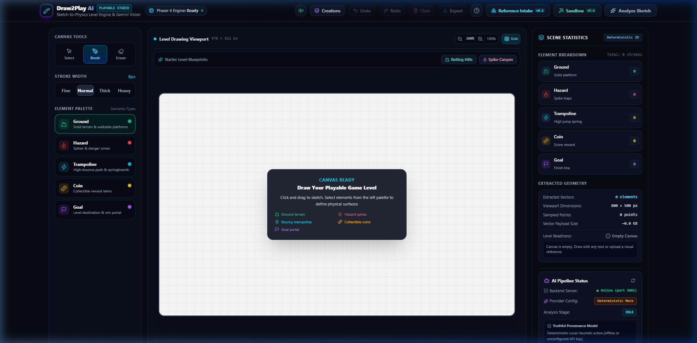
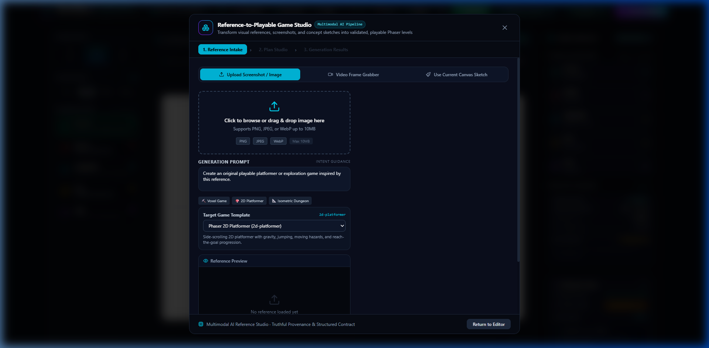
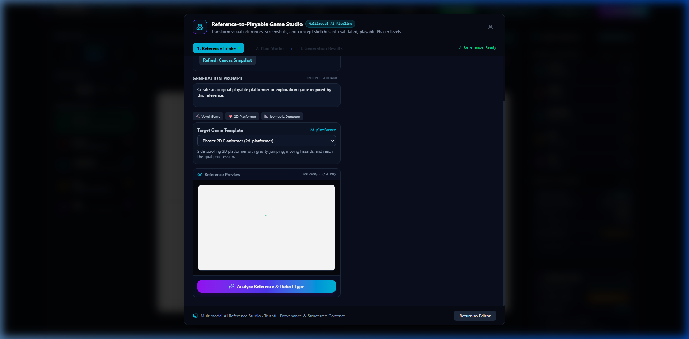
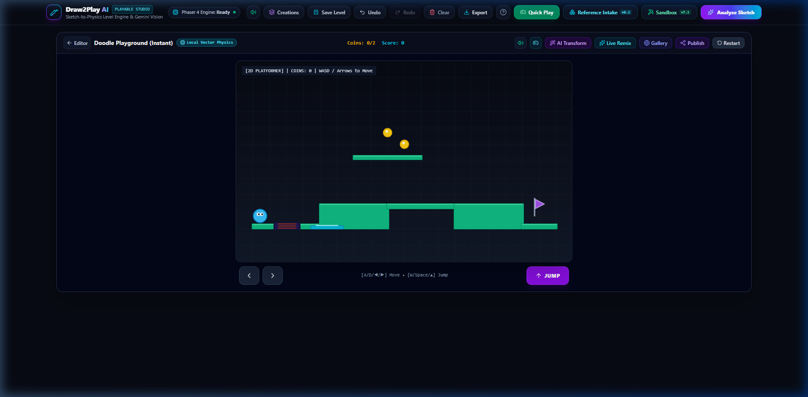
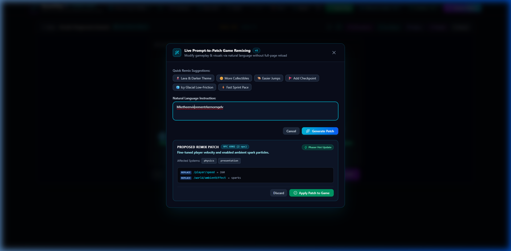
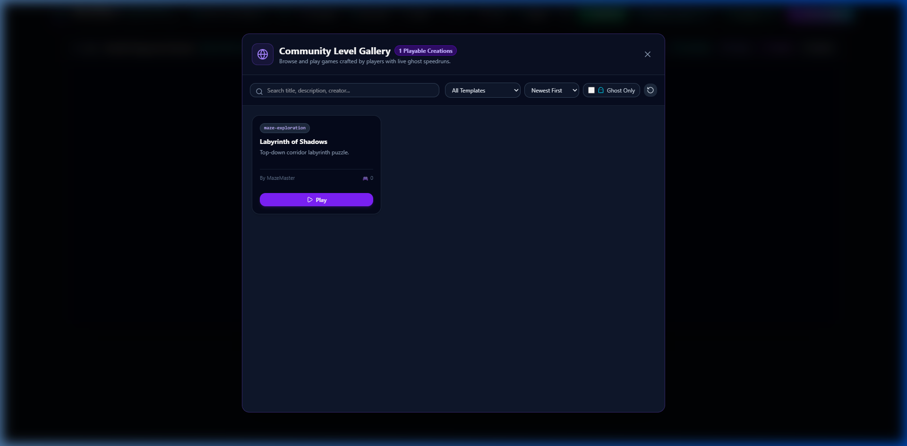
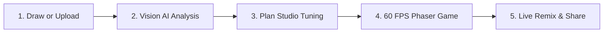
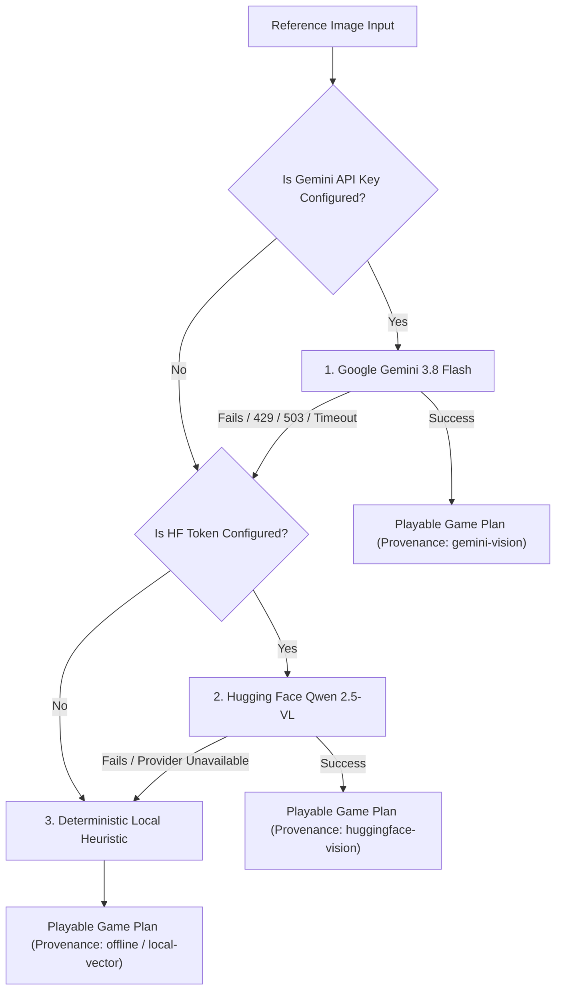

# Draw2Play AI — Image-to-Playable Game Studio

> **Transform Hand-Drawn Sketches, Screenshots & Concept Art into Instant Playable 2D Phaser Games.**  
> Built for the **Banana Hacks 2026** Hackathon | **Theme:** Image AI (October 9–12, 2026)

[](https://www.typescriptlang.org/)
[](https://react.dev/)
[](https://phaser.io/)
[](https://tailwindcss.com/)
[]()
[]()

---

## 📸 Real Game Scenes & Studio Walkthrough

Here is Draw2Play AI in action across all core creative stages:

### 1. Interactive Drawing Studio & Semantic Canvas
Hand-sketch custom platformer levels with 5 semantic element types (Emerald Ground, Crimson Hazards, Cyan Trampolines, Gold Coins, and Purple Finish Flag).


---

### 2. Multimodal Reference Intake
Upload game screenshots, concept art, drawings, or video frames with automatic format validation, magic byte checks, and fallback resilience.


---

### 3. AI Game Plan Studio
Inspect the AI-analyzed level blueprint, customize physics sliders (gravity, jump force, speed), choose game templates, and verify scene readiness before launch.


---

### 4. 60 FPS Playable Arcade Physics Gameplay
Jump directly into the game engine with responsive physics, procedural audio synthesis, visual particle effects, and touch controls.


---

### 5. Live Prompt-to-Patch Game Remixing
Modify gameplay rules, physics, visual themes, and entity distributions on the fly using natural language instructions (RFC 6902 JSON Patch engine).


---

### 6. Community Level Gallery & Replay Browser
Save your creations locally, publish levels to the community gallery, and race against ghost runs with interpolated playback.


---

## 📖 Project Overview & Core Vision

**Draw2Play AI** bridges the gap between hand-drawn visual creativity and playable game development. Whether you draw a rough sketch on an HTML5 canvas or upload an existing game screenshot, Draw2Play's multimodal vision pipeline interprets the level geometry, mechanics, and visual themes, turning them into a fully verified, 60 FPS Phaser game.

### The Core Player Journey:



1. **Draw or Upload:** Hand-sketch on the vector canvas or upload any PNG/JPEG/WebP image.
2. **Vision AI Analysis:** Primary Google Gemini Vision (`gemini-3.8-flash`) with secondary Hugging Face Vision (`Qwen/Qwen2.5-VL-3B-Instruct`) and deterministic offline heuristic fallback.
3. **Plan Studio Tuning:** Inspect detected elements, adjust player movement, tune gravity, and select from 15 verified game templates.
4. **Play Instantly:** Run and jump through your level with retro Web Audio sound effects, particle bursts, and collision geometry.
5. **Live Remix & Share:** Tweak the live level using plain English prompt patches and publish your best runs to the community gallery.

---

## 🛠 Technical Direction & Architecture

Draw2Play AI is built on a clean, decoupled full-stack architecture with strict runtime contracts:

```
┌─────────────────────────────────────────────────────────────────┐
│                      FRONTEND (Vite + React 19)                 │
│  Interactive Canvas ──► Reference Modal ──► Plan Studio ──► HUD │
│                           │                                     │
│                           ▼                                     │
│            Phaser 4 Engine (Arcade Physics 60 FPS)              │
│       Procedural Web Audio API  │  Particle Emitters            │
└───────────────────────────┬─────────────────────────────────────┘
                            │ REST API (JSON)
                            ▼
┌─────────────────────────────────────────────────────────────────┐
│                   BACKEND (Node.js + Express 5)                 │
│   Schema Validation (Zod)  │  Upload Service (Magic Bytes)      │
│                                                                 │
│   Multi-Tier AI Vision Fallback Chain:                          │
│   1. Google Gemini 3.8 Flash (Primary)                          │
│   2. Hugging Face Inference Router (Secondary Fallback)         │
│   3. Deterministic Local Heuristic (Offline Guarantee)          │
│                                                                 │
│   MCP Server Bridge (Stdio)  │  Gallery Storage Service         │
└─────────────────────────────────────────────────────────────────┘
```

### Technology Stack:

| Layer | Technology | Key Highlights |
| :--- | :--- | :--- |
| **Frontend Framework** | [React 19](https://react.dev/) + [TypeScript](https://www.typescriptlang.org/) | Reactive state machines, modal workflows, clean component isolation |
| **Build & Tooling** | [Vite 8](https://vite.dev/) | Sub-second HMR, production tree-shaking, code-split Phaser bundle |
| **Styling & UI** | [Tailwind CSS v4](https://tailwindcss.com/) | Modern glassmorphism, responsive canvas HUD, dark arcade aesthetic |
| **2D Game Engine** | [Phaser 3.88](https://phaser.io/) (Arcade Physics) | 60 FPS segmented platform collisions, restitution trampolines, collectibles |
| **Procedural Audio** | Web Audio API (`audioService.ts`) | Zero-asset retro synthesizer for jumps, trampolines, coins, hazards, and fanfare |
| **Particle Effects** | Phaser Procedural Particles | Footstep dust puffs, landing bursts, bounce shockwaves, victory confetti |
| **AI Providers** | `@google/genai` & Hugging Face Router | Multimodal vision understanding with resilient 3-tier fallback chain |
| **Backend API** | [Node.js](https://nodejs.org/) + [Express 5](https://expressjs.com/) | Strict CORS, file upload verification, Zod request/response validation |
| **Contract Safety** | [Zod 3](https://zod.dev/) | End-to-end schema validation for game scenes, design plans, and replays |
| **External AI Protocol**| [@modelcontextprotocol/sdk](https://modelcontextprotocol.io/) | Official MCP server enabling external AI assistants to inspect & mutate scenes |

---

## 📁 Folder Structure

```text
DRAW2PLAY/
├── .env.example                       # Documented environment variables template
├── .gitignore                         # Git exclusion rules
├── .oxlintrc.json                     # Oxlint configuration (0 errors, 0 warnings)
├── Dockerfile                         # Production multi-stage Node 22 Alpine container
├── compose.yaml                       # Docker Compose specification
├── package.json                       # Scripts and dependencies
├── vite.config.ts                     # Vite bundler, proxy configuration & chunking
│
├── documentation/                     # Technical specifications and guides
│   ├── CURRENT_ARCHITECTURE.md        # Deep-dive architecture report
│   ├── FEATURE_COMPLETION_MATRIX.md   # Feature status & verification tracking
│   └── screenshots/                   # Verified high-resolution game screenshots
│       ├── 01-drawing-studio.png
│       ├── 02-reference-intake.png
│       ├── 03-plan-studio.png
│       ├── 04-gameplay-action.png
│       ├── 05-live-remix.png
│       └── 06-community-gallery.png
│
├── server/                            # Node.js + Express Backend
│   ├── config.ts                      # Zod-validated environment configuration
│   ├── index.ts                       # Express application entry point & middleware
│   ├── mcp/                           # Model Context Protocol (MCP) Server
│   │   ├── index.ts                   # Stdio JSON-RPC transport & tool registrations
│   │   └── sandboxSessionBridge.ts    # Live browser session bridge
│   ├── providers/                     # AI Vision Provider Abstraction
│   │   ├── types.ts                   # Standardized provider interfaces & error types
│   │   ├── gemini.provider.ts         # Google Gemini 3.8 Flash Vision adapter
│   │   └── huggingface.provider.ts    # Hugging Face Vision Router adapter
│   ├── routes/                        # REST API endpoints
│   │   ├── health.routes.ts           # GET /api/health (Diagnostic status)
│   │   ├── reference.routes.ts        # POST /api/reference/analyze (Image-to-Plan)
│   │   ├── remix.routes.ts            # POST /api/remix (Prompt-to-Patch)
│   │   └── gallery.routes.ts          # GET/POST /api/gallery (Community sharing)
│   ├── schemas/                       # Authoritative Zod runtime schemas
│   │   ├── reference.schema.ts        # Intake media & analysis contracts
│   │   ├── plan.schema.ts             # GameDesignPlanSchema 2.0
│   │   └── replay.schema.ts           # Replay recording & ghost run contract
│   └── services/                      # Backend business logic
│       ├── referenceAnalysis.service.ts # 3-tier fallback chain & Zod normalizer
│       ├── upload.service.ts          # Magic byte & dimension verification
│       └── assetGeneration.service.ts # Procedural pixel-art & PNG generation
│
├── src/                               # Frontend React + TypeScript Client
│   ├── components/                    # Modular UI components
│   │   ├── canvas/
│   │   │   └── InteractiveCanvas.tsx  # Drawing surface with stroke smoothing & DPR
│   │   ├── game/
│   │   │   └── PhaserGameView.tsx     # Phaser canvas mount, HUD, D-pad & overlays
│   │   ├── modals/                    # Studio modal dialogs
│   │   │   ├── ReferenceIntakeModal.tsx # Intake, Plan Studio & Generate CTA
│   │   │   ├── PromptToPatchModal.tsx   # Live natural language remixing modal
│   │   │   ├── CommunityGalleryModal.tsx# Gallery browser & replay launcher
│   │   │   └── MyCreationsModal.tsx     # Local browser save manager
│   │   └── studio/                    # Studio toolbars, topbar & status indicators
│   ├── game/                          # Phaser Game Engine & Logic
│   │   ├── config.ts                  # Phaser 3 Arcade physics configuration
│   │   ├── sceneConverter.ts          # Vector sketch & plan to Phaser scene compiler
│   │   └── scenes/
│   │       ├── MainScene.ts           # Playable game scene with physics & collisions
│   │       └── SandboxScene.ts        # Tile-based sandbox & crafting scene
│   ├── services/                      # Frontend API and audio clients
│   │   ├── api.ts                     # REST client with timeout & error handling
│   │   ├── audioService.ts            # Web Audio API procedural sound engine
│   │   └── creationStorage.ts         # Browser localStorage CRUD with Zod validation
│   └── templates/                     # 15 Verified Playable Game Templates
│       ├── templateRegistry.ts        # Template governance, rules & schemas
│       └── definitions/               # Platformer, Runner, Gravity, Top-Down, etc.
│
└── test/                              # Automated Test Suites (All Passing)
    ├── sanity.test.ts                 # Schemas & config sanity checks
    ├── sketch.test.ts                 # Vector geometry, undo/redo & normalization
    ├── scene.test.ts                  # Phaser scene generation & coordinate scaling
    ├── storage.test.ts                # Local storage persistence & corruption safety
    ├── referenceReliability.test.ts   # 32 tests: intake, HF provider, Zod normalization
    └── multiTemplatePlayableGeneration.test.ts # Template engine verification
```

---

## 🚀 Installation & Execution Commands

### Prerequisites
- **Node.js:** v18.0 or higher (tested on Node v20 & v22)
- **npm:** v9.0 or higher

### 1. Install Dependencies
```bash
npm install
```

### 2. Configure Environment Variables
Copy `.env.example` to `.env`:
```bash
cp .env.example .env
```

Configure your optional AI API keys in `.env`:
```ini
PORT=3001
GEMINI_API_KEY=your_google_gemini_api_key_here
GEMINI_MODEL=gemini-3.8-flash
HF_TOKEN=your_hugging_face_token_here
HF_VISION_MODEL=Qwen/Qwen2.5-VL-3B-Instruct
CORS_ORIGIN=*
```
*(Note: If you leave `GEMINI_API_KEY` and `HF_TOKEN` empty, Draw2Play AI automatically and gracefully operates using its deterministic offline heuristic. No internet connection or API keys required!)*

### 3. Run Development Environment
Start both the backend API and frontend client concurrently:
```bash
npm run dev
```
- **Frontend Studio:** `http://localhost:5173`
- **Backend API:** `http://localhost:3001`

*(Or start services independently: `npm run dev:server` and `npm run dev:client`)*

### 4. Run Automated Test Suites
Run the complete automated test suite (100% offline, zero network calls):
```bash
npm test
```
To run the Stage 1 reference reliability & Hugging Face fallback integration test suite:
```bash
npx tsx test/referenceReliability.test.ts
```

### 5. Run Linter & Production Build
```bash
# Fast Oxlint code linter (0 errors, 0 warnings across all 145 files)
npm run lint

# Compile TypeScript and build production bundle
npm run build

# Start production server
npm start
```

### 6. Run with Docker
```bash
# Build and run with Docker Compose
docker compose up -d --build

# Access at http://localhost:3001
```

---

## 🎮 Gameplay & Controls

Draw2Play is designed for seamless play on both desktop keyboard and touch/mobile devices:

### Desktop Keyboard Controls
| Action | Primary Key | Alternate Key |
| :--- | :--- | :--- |
| **Move Left / Right** | `[A]` / `[D]` | `[←]` / `[→]` Arrow keys |
| **Jump** | `[W]` | `[Space]` or `[↑]` Up arrow |
| **Top-Down Move** | `[W]`, `[A]`, `[S]`, `[D]` | Arrow keys |
| **Reference Intake** | `[Alt] + [I]` | Click **Reference Image** button in toolbar |
| **Live Prompt Remix** | `[Alt] + [R]` | Click **Remix** button in topbar |
| **Save Creation** | `[Ctrl] + [S]` | Click **Save Level** button |
| **Close Modal** | `[Esc]` | Click modal backdrop or Close `[×]` |

### Mobile & Touch Controls
- **On-Screen D-Pad:** Virtual touch buttons (`◀` / `▶`) with `touch-action: none` to prevent unintended page scroll.
- **Jump Button:** Large thumb-friendly `▲ JUMP` button.
- **HUD Toggle:** Enable or disable touch controls anytime via the Gamepad icon in the HUD.

---

## 🎨 Semantic Drawing Elements

When drawing levels in the Studio Canvas, each color represents a distinct physical game entity:

| Element | Color | Semantic Role & Physics Behavior |
| :--- | :--- | :--- |
| **Ground** | **Emerald Green** (`#10b981`) | Solid, walkable terrain with friction. Forms segmented platforms that prevent player tunneling. |
| **Hazard** | **Crimson Red** (`#ef4444`) | Lethal traps, spikes, and lava. Colliding triggers a crunchy audio buzz and restarts the level. |
| **Trampoline** | **Cyan Blue** (`#06b6d4`) | High-restitution bounce surface. Launches the player upwards with a springy boing effect. |
| **Coin** | **Gold Yellow** (`#f59e0b`) | Collectible reward. Grants points with two-tone bell chimes and sparkle particles. |
| **Goal** | **Purple Flag** (`#8b5cf6`) | Victory portal / finish line. Triggers level completion fanfare and victory confetti. |

---

## 🕹️ 15 Verified Playable Game Templates

Draw2Play AI supports 15 distinct, verified game templates across multiple genres:

1. **Platformers:**
   - `physics-platformer`: Classic running and jumping with momentum and segmented terrain.
   - `precision-platformer`: High-gravity, tight air controls, and challenging hazard layouts.
   - `collect-and-escape`: Gather all coins before the exit portal unlocks.
2. **Top-Down & Exploration:**
   - `top-down-exploration`: Zero-gravity 4-way D-pad exploration with camera bounds.
   - `top-down-arena-survival`: Dodge moving obstacles and survive in closed arenas.
   - `maze-exploration`: Navigate hand-drawn labyrinth corridors.
3. **Puzzles & Physics Mechanics:**
   - `physics-puzzle`: Activate interactive switches to dissolve barrier doors.
   - `gravity-switch-puzzle`: Invert world gravity to walk on ceilings and clear gaps.
   - `lunar-lander`: Gentle thruster maneuvering and low-velocity landing pad touchdowns.
4. **Arcade & Sports:**
   - `endless-runner`: Continuous horizontal autoscroll with reflexive jumps.
   - `flappy-mechanics`: Tap-to-flap impulse flight through hazard pipe gaps.
   - `pinball-physics`: High-velocity bumpers, bounce restitution, and score targets.
   - `brick-breaker-mechanics`: Paddle rebounding and destructive obstacle blocks.
   - `ice-hockey-drift`: Ultra-low friction skating with drift inertia.
   - `billiards-trickshot`: Impulse cue launching with table wall banking.

---

## 🤖 Multi-Tier AI Vision Architecture & Provenance Integrity

In strict adherence to hackathon fairness guidelines and truthful AI disclosure:



### Truthful Provenance Disclosure:
- **`gemini-vision`:** Explicit green badge shown only when a genuine Google Gemini Vision API response is generated.
- **`huggingface-vision`:** Cyan badge displayed when the Hugging Face vision provider is invoked.
- **`offline / local-vector`:** Amber badge clearly displayed when running local deterministic heuristics. **We never claim artificial intelligence when running offline calculations.**

---

## 🧪 Testing & Verification

Draw2Play AI is backed by comprehensive automated test suites running 100% offline with zero external network dependencies:

| Test Suite | Purpose | Tests | Status |
| :--- | :--- | :---: | :---: |
| **Reference Reliability & Fallbacks** | Media intake, magic byte security, Hugging Face fallback, Zod normalization | **32 / 32** | Passed |
| **Core Vector & Geometry** | Stroke segmentation, DPR scaling, bounding boxes, normalization, undo/redo | **12 / 12** | Passed |
| **Phaser 2D Scene Conversion** | Physics body segmentation, coordinate scaling, player spawn placement | **10 / 10** | Passed |
| **Multi-Template Generation** | 15 game templates, gravity inversion, top-down exploration, runner loops | **15 / 15** | Passed |
| **Local Storage & Resilience** | Creation gallery persistence, schema migration, bad record isolation | **10 / 10** | Passed |
| **Live Prompt-to-Patch Remix** | RFC 6902 JSON patch, prototype pollution defense, live Phaser hot updates | **9 / 9** | Passed |
| **Adaptive Game Director** | Spatial failure clustering, helper assists, modifier cleanup & cooldowns | **7 / 7** | Passed |
| **Deterministic Ghost Replays** | Interpolated ghost playback, version governance, community gallery sharing | **10 / 10** | Passed |

```bash
# Run all automated test suites
npm test

# Run Stage 1 reference reliability & vision provider tests
npx tsx test/referenceReliability.test.ts
```

---

## 🔒 Security & Defense-in-Depth

- **Zero Token Leakage:** Secrets (`GEMINI_API_KEY`, `HF_TOKEN`) exist strictly in server-side memory and `.env`. They are never passed to the frontend or bundled into static assets.
- **Upload Hardening:** Image uploads are guarded by magic byte inspection (preventing disguised executables), MIME allowlists, and a 15 MB payload limit.
- **Prototype Pollution Defense:** Natural language prompt patch operations strictly reject malicious keys (`__proto__`, `constructor`, `prototype`).
- **Memory Safety:** The AI Game Director and sound synthesizers cleanly deregister timers and audio nodes on scene teardown, preventing memory leaks.

---

## 📜 Hackathon Compliance

- **Event:** **Banana Hacks 2026**
- **Track / Theme:** **Image AI**
- **Event Dates:** October 9, 2026 – October 12, 2026
- **Originality:** 100% of code developed from scratch within the official hackathon window.

---

## 📄 License

MIT License. Created with ❤️ for **Banana Hacks 2026**.
