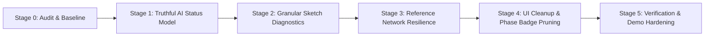

# Draw2Play AI — Implementation Roadmap

**Document Version:** 1.0  
**Audit Baseline Commit:** `9023cd2`  
**Goal:** Resolve all confirmed defects, implement a truthful AI pipeline status model, provide actionable sketch-analysis feedback, eliminate network failure confusion, and prepare the project for stable public demo.

---

## Stage Progression Overview

---

## Detailed Stage Plans

### Stage 1: Truthful AI Pipeline Status Model
**Priority:** High (Direct user-reported defect)  
**Objective:** Replace the binary `geminiConfigured` boolean and stale Phase 3 text with an expressive, truthful status model that accurately reflects backend health, provider configuration, active analysis, and fallback reasons.

#### 1. Status States:
- `checking`: Probing backend availability and provider registry.
- `gemini-ready`: Backend online; `GEMINI_API_KEY` configured and verified; ready for multimodal vision.
- `gemini-active`: Actively running Gemini Vision analysis on a sketch or reference media.
- `mock-fallback`: Backend online; operating in deterministic fallback mode (no `GEMINI_API_KEY` or transparent fallback selected).
- `configuration-error`: Backend online; `GEMINI_API_KEY` invalid, model mismatch, or unauthorized (HTTP 401/403).
- `request-error`: Backend offline (port 3001 closed, 502 Bad Gateway), request timeout (504), or network error.

#### 2. Key Changes:
- Create `src/types/aiStatus.ts` defining `AiPipelineStatus`, `AiStatusDetails`, and helper descriptions.
- Update `src/App.tsx` to maintain rich `aiStatus` state, populated via `fetchHealth()` and `/api/ai/providers`.
- Refactor `src/components/studio/ScenePanel.tsx`:
  - Delete hardcoded "Awaiting Phase 3 Vision Hand-off" text.
  - Display actual status state, provider name (`Google Gemini 3.8 Flash` vs `Deterministic Local Heuristic`), and last request outcome.
  - Show explicit fallback rationale when operating without a key.
- Update `AnalyzePreparationModal.tsx` to reflect the truthful status.

#### 3. Acceptance Criteria:
- No mentions of "Phase 3" appear in `ScenePanel.tsx`.
- When backend is down (port 3001 closed), status truthfully indicates `request-error` ("Backend server offline or unreachable on port 3001").
- When backend is running without key, status truthfully indicates `mock-fallback` ("Deterministic Fallback Active").
- During analysis, status switches to `gemini-active` or `checking`.

---

### Stage 2: Granular, Actionable Sketch-Analysis Diagnostics
**Priority:** High (Direct user-reported defect)  
**Objective:** Replace rigid `"Needs Ground & Goal"` text with specific, educational level readiness diagnostics.

#### 1. Key Changes:
- Refactor `calculateSceneSummary()` in `src/utils/sketchSerializer.ts` to compute specific missing requirements:
  - `missingElements`: array containing `'ground'`, `'goal'`, or empty if ready.
  - `readinessStatus`: `'ready' | 'missing-ground' | 'missing-goal' | 'missing-both' | 'empty'`.
  - `actionableGuidance`: human-readable sentence instructing the player how to fix their sketch.
- Update `src/components/studio/ScenePanel.tsx`:
  - Show stroke count vs extracted vector element count clearly.
  - Display specific badge for readiness:
    - If ready: `Ready to Play` (Emerald with Check icon).
    - If missing ground only: `Missing Ground (Solid Platforms)` with hint: *"Select the Emerald Ground tool to draw walkable surfaces."*
    - If missing goal only: `Missing Goal (Finish Flag)` with hint: *"Select the Purple Goal tool to place the level finish line."*
    - If missing both: `Missing Ground & Goal` with hint: *"Every level requires at least one platform and a finish flag."*
- Update `src/components/studio/BottomStatusBar.tsx`:
  - Synchronize status with `readinessStatus` to avoid reporting only "Missing Ground" when both are absent.

#### 2. Acceptance Criteria:
- Drawing only Ground reports "Missing Goal (Finish Flag)" and tells the user how to fix it.
- Drawing only Goal reports "Missing Ground (Solid Platforms)" and tells the user how to fix it.
- Drawing 0 strokes reports "Empty Canvas".
- Drawing Ground and Goal reports "Ready to Play".

---

### Stage 3: Reference Intake Network Resilience & Error Diagnosis
**Priority:** High (Direct user-reported defect)  
**Objective:** Prevent cryptic 502/413 errors during reference image upload and analysis by adding proactive health checking, body-limit warnings, and clear error recovery.

#### 1. Key Changes:
- In `ReferenceIntakeModal.tsx`:
  - Check backend connectivity before attempting upload/analysis. If down, display a helpful banner: *"Backend API server is not running on port 3001. Please run `npm run dev:server` or `npm start`."*
  - Pre-flight check client image byte size: if `> 10MB` or base64 `> 14MB`, warn user to downsample or compress image before sending.
  - For multi-frame video analysis: explain that multi-frame requires a live `GEMINI_API_KEY` before triggering the request, offering single-frame analysis with fallback instead.
  - Do not silently swallow `/upload` failures; surface the exact reason.

#### 2. Acceptance Criteria:
- If port 3001 is closed, clicking Analyze shows an actionable server connection message instead of a raw 502 exception.
- Uploads exceeding limits show clear payload size guidance.

---

### Stage 4: UI Cleanup & Phase Badge Pruning
**Priority:** Medium (Cosmetic and polish)  
**Objective:** Remove obsolete Phase badges across the application that confuse users into thinking features are unfinished or stuck in older milestones.

#### 1. Key Changes:
- Remove `Phase 3` from `StudioHeader.tsx`.
- Remove `v6.1` and `v7.1` badges from `TopBar.tsx`.
- Clean up `Phase 8: Crafting` badge in `SandboxGameView.tsx`.
- Clean up `Phase 7.2 AI` badge in `DrawToCraftModal.tsx`.
- Clean up `Phase 6.2` references in `ReferenceIntakeModal.tsx`.
- Delete or archive dead prototype `src/components/studio/CanvasViewport.tsx` and `DrawingToolbar.tsx`.

#### 2. Acceptance Criteria:
- No obsolete milestone badges appear in the active UI.

---

### Stage 5: Verification, Tests & Final Demo Hardening
**Priority:** High  
**Objective:** Add comprehensive automated regression tests and verify full build integrity.

#### 1. Tests to Add:
- Test truthful AI status transitions (`checking` -> `gemini-ready` / `mock-fallback` / `request-error`).
- Test granular sketch diagnostics (`missing-ground`, `missing-goal`, `missing-both`, `ready`).
- Test removal of obsolete Phase 3 text from rendered components.
- Test reference intake error reporting for offline backends and oversized files.

#### 2. Acceptance Criteria:
- All new and existing test suites pass (`npm test`).
- 0 lint errors/warnings (`npm run lint`).
- Clean production build (`npm run build`).
